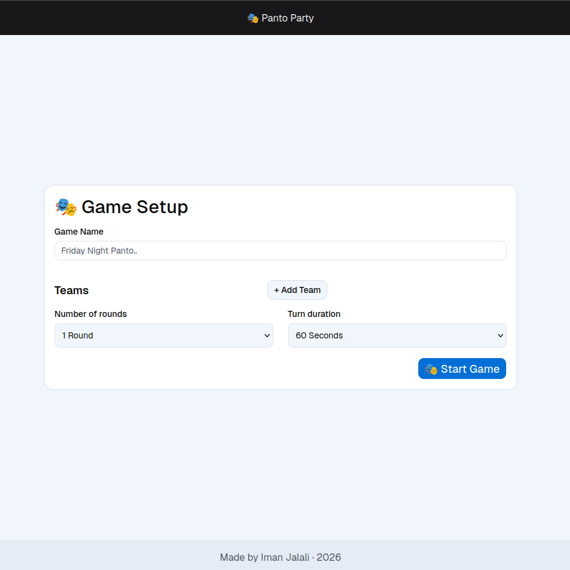
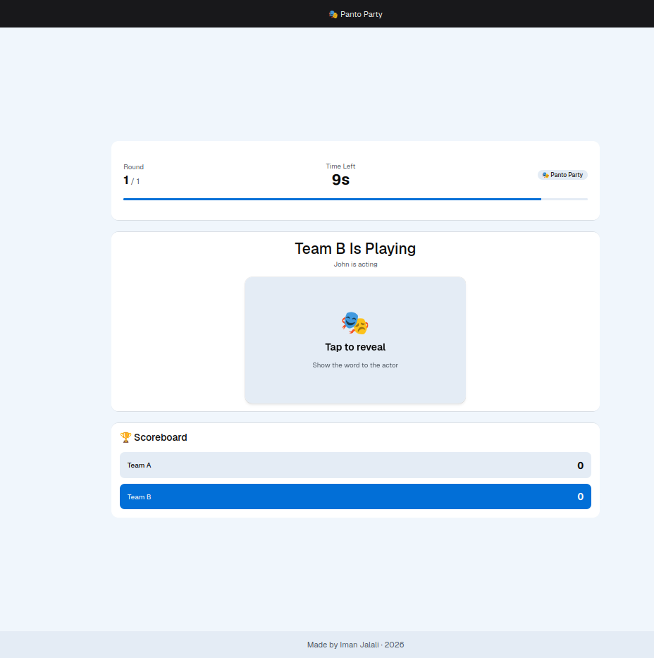
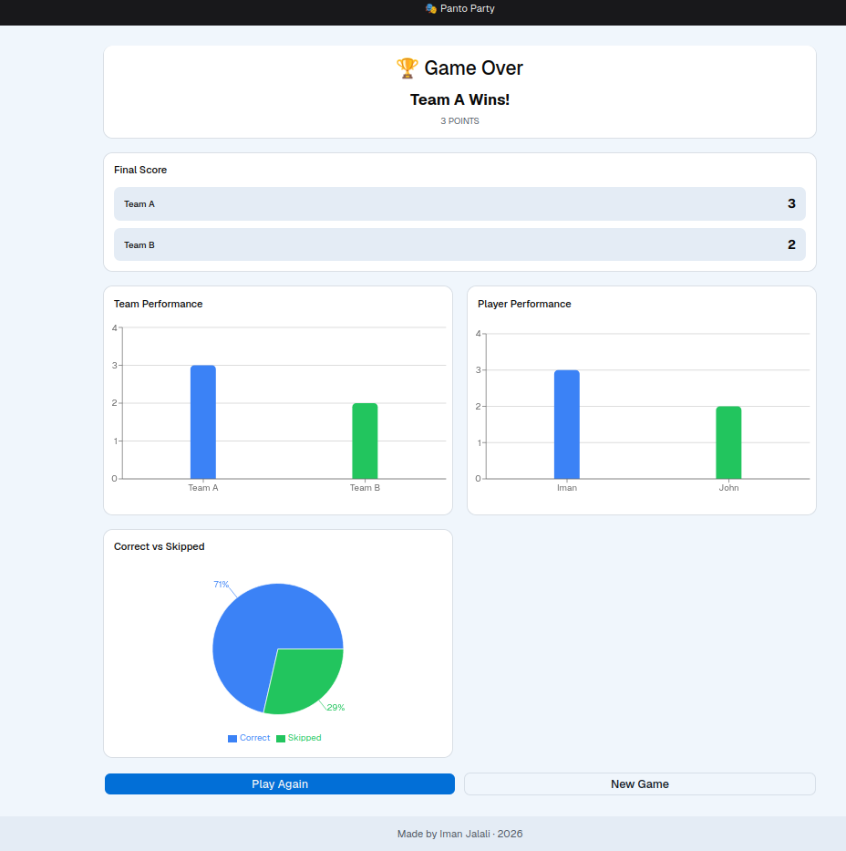

# 🎭 Panto Party

A multiplayer **Pantomime / Charades game** built with **React, TypeScript, and React Router**.

Panto Party is a browser-based party game where players form teams, take turns acting out words, and compete to achieve the highest score. The application manages the complete game flow — from configuring teams and players to timed gameplay and final performance results.

## 🎮 Live Demo

### [🚀 Play Panto Party](https://panto-party.vercel.app/)

Try the live version of the game directly in your browser — no installation required.

---

## ✨ Features

- 🎮 Team-based Pantomime / Charades gameplay
- 👥 Create and manage multiple teams
- 🧑‍🤝‍🧑 Add and manage players for each team
- ⏱️ Configurable turn duration
- 🔄 Configurable number of rounds
- 🎲 Random word selection
- 🃏 Interactive animated word card
- ✅ Mark words as correctly guessed
- ⏭️ Skip words
- ⏳ Automatic turn timer
- 🔀 Player and team rotation
- 📊 Team score tracking
- 👤 Player performance tracking
- 📈 Team and player performance charts
- 🏆 Final scoreboard and game results
- 🎉 Celebration effects
- 🔊 Sound effects
- 📝 Form validation
- 📱 Responsive design
- 🧩 Reusable UI components
- 💾 Centralized game state management with Zustand

---

## 🎯 Game Overview

Panto Party follows a simple but complete game loop.

Players first configure their game by choosing the game name, number of rounds, turn duration, teams, and players.

Once the game starts, players take turns acting out randomly selected words. Their teammates attempt to guess the word before the timer runs out.

Successfully guessed words increase the team's score, while skipped words do not contribute to the score.

The game continues through the configured rounds and automatically manages the transition between teams and players.

At the end of the game, the application presents the final scores and performance information.

---

## 🎮 Game Flow

```text
┌─────────────┐
│    Home     │
└──────┬──────┘
       │
       ▼
┌─────────────┐
│ Game Setup  │
└──────┬──────┘
       │
       ▼
┌─────────────┐
│ Start Game  │
└──────┬──────┘
       │
       ▼
┌────────────────┐
│  Player Turn   │
│                │
│  ┌──────────┐  │
│  │ WordCard │  │
│  └──────────┘  │
└───────┬────────┘
        │
        ├───────────────┐
        │               │
        ▼               ▼
    ┌───────┐       ┌──────┐
    │Correct│       │ Skip │
    └───┬───┘       └──┬───┘
        │              │
        └──────┬───────┘
               │
               ▼
          Next Word
               │
               ▼
        Timer Expires
               │
               ▼
          Next Turn
               │
               ▼
        Next Team / Player
               │
               ▼
          Next Round
               │
               ▼
          Game Over
               │
               ▼
       Final Results
```

---

## ⚙️ Game Setup

Before starting a game, players can configure the main game settings.

### Game Settings

- Game name
- Turn duration
- Number of rounds

### Team Management

Players can dynamically:

- Add teams
- Remove teams
- Add players
- Remove players

The setup form uses **React Hook Form** for form state management and **Zod** for validation.

---

## ⏱️ Timed Gameplay

Each turn has a configurable duration.

The game timer is integrated with the centralized game state and controls the transition from the current turn to the next one.

When the timer reaches the end of a turn, the game automatically moves forward according to the current round and team state.

This ensures that the game follows the configured number of rounds.

---

## 🃏 Word System

Words are stored as typed data and selected during gameplay.

Each word has a unique identifier and text value.

The game keeps track of played words so that words are not repeatedly selected while unused words are still available.

When the available words have been exhausted, the word state can be reset to allow gameplay to continue.

Players can either mark the current word as:

- **Correct** — the team earns a point and gameplay continues with another word.
- **Skip** — the word is skipped and gameplay continues.

This allows multiple words to be played during a single timed turn.

---

## 👥 Player Rotation

The game keeps track of which players have already taken a turn.

Players are not selected repeatedly before the remaining players have had an opportunity to play.

The store maintains this information per team, allowing the game to rotate through players while preserving the current team and round state.

---

## 🏆 Scoring System

Scores are maintained for each team throughout the game.

When a word is successfully guessed, the corresponding team's score is increased.

The game state keeps scores indexed by team ID, making the scoring system independent from the UI components.

At the end of the game, the highest score is used to determine the winning team or teams.

If multiple teams share the highest score, the result can be represented as a tie.

---

## 📊 Performance & Results

The Game Over section provides more than just the final score.

### Team Performance

Team performance can be visualized and compared using charts.

### Player Performance

Individual player performance can also be displayed, providing more detailed information about how players contributed to the game.

Charts are implemented using **Recharts**.

---

## 📸 Screenshots

### Game Setup

Configure the game, turn duration, number of rounds, teams, and players.



### Gameplay

The main gameplay screen with the current team, player, timer, word card, and game actions.



### Game Over

Review the final scores and performance results after the game has finished.



### Adding Screenshots

Create a `screenshots` folder inside `public` and add the following files:

```text
public/
└── screenshots/
    ├── game-setup.png
    ├── game.png
    └── game-over.png
```

---

## 🛠️ Tech Stack

### Core

- **React 19** — UI development
- **TypeScript** — Static typing and type safety
- **React Router** — Routing and application structure
- **Vite** — Development server and build tooling

### State & Forms

- **Zustand** — Global game state management
- **React Hook Form** — Form state and dynamic fields
- **Zod** — Schema-based validation
- **@hookform/resolvers** — Connecting Zod validation with React Hook Form

### UI & Styling

- **Tailwind CSS** — Utility-first styling
- **shadcn/ui** — Reusable UI components
- **Lucide React** — Icons
- **Geist** — Application typography

### Visualization & UX

- **Recharts** — Performance charts
- **Canvas Confetti** — Celebration effects
- **Nanoid** — Unique identifiers

---

## 🧠 State Management

The application uses **Zustand** as the central state management solution.

The game store contains the state required to coordinate the different stages of gameplay.

Important state includes:

```text
Game Setup
├── Game name
├── Turn duration
├── Number of rounds
├── Teams
└── Players

Game Play
├── Current team
├── Current player
├── Current round
├── Remaining time
├── Team scores
├── Played players
├── Played words
├── Current word
├── Word visibility
└── Game over state
```

Centralizing these values allows different components to react to the same game state without passing gameplay information through multiple layers of props.

---

## 🔄 Game State Transitions

The store is responsible for gameplay transitions such as:

- Starting the game
- Selecting the next player
- Moving to the next team
- Advancing rounds
- Decreasing the timer
- Ending a turn
- Updating scores
- Selecting another word
- Determining when the game is over

The game-over condition is based on reaching the configured final round and final team turn.

---

## 📝 Form Architecture

The Game Setup form is implemented with **React Hook Form** and dynamically manages teams and players.

The form uses typed default values and dynamic field arrays, allowing the number of teams and players to change without maintaining separate local state for every field.

Validation is handled through a dedicated **Zod schema**.

This combination provides:

- Strongly typed form data
- Centralized validation rules
- Dynamic team fields
- Dynamic player fields
- Consistent error handling

---

## 🧩 Component Architecture

The application separates reusable UI components from game-specific components.

### Game Components

Game-specific functionality is organized under:

```text
app/components/game/
```

These components are responsible for functionality such as:

- Word cards
- Game actions
- Final scores
- Game results
- Team performance
- Player performance
- Score comparisons

### UI Components

Reusable interface components are organized under:

```text
app/components/ui/
```

This keeps generic interface elements separate from game-specific functionality.

---

## 🃏 Word Card Animation

The word card includes a custom flip animation.

The animation uses CSS concepts such as:

- `perspective`
- `transform-style: preserve-3d`
- `backface-visibility`
- 3D rotation
- CSS transitions

The card interaction provides visual feedback when the word is revealed and creates a more game-like experience than simply displaying static text.

---

## 🎨 UI / UX

The interface combines Tailwind CSS with reusable shadcn/ui components.

The design focuses on keeping the game interface clear while the player is actively playing.

The application includes:

- Responsive layouts
- Reusable buttons and form controls
- Visual feedback for game actions
- Animated interactions
- Timer feedback
- Performance visualizations
- Celebration effects
- Sound effects

---

## 📱 Responsive Design

Panto Party is designed to work across different screen sizes.

The layouts adapt to smaller screens while preserving the main gameplay functionality.

Particular attention is given to:

- Game setup forms
- Team and player management
- Gameplay controls
- Game results
- Performance charts

---

## 📁 Project Structure

```text
panto-party/
│
├── app/
│   │
│   ├── components/
│   │   ├── game/
│   │   │   ├── CorrectVsSkipped.tsx
│   │   │   ├── FinalScore.tsx
│   │   │   ├── GameActions.tsx
│   │   │   ├── GameResult.tsx
│   │   │   ├── PlayerPerformance.tsx
│   │   │   ├── TeamPerformance.tsx
│   │   │   ├── WordCard.tsx
│   │   │   └── WordCard.css
│   │   │
│   │   └── ui/
│   │       ├── badge.tsx
│   │       ├── button.tsx
│   │       ├── card.tsx
│   │       ├── field.tsx
│   │       ├── input.tsx
│   │       ├── label.tsx
│   │       ├── progress.tsx
│   │       ├── select.tsx
│   │       └── separator.tsx
│   │
│   ├── data/
│   │   └── words.ts
│   │
│   ├── layouts/
│   │
│   ├── lib/
│   │   ├── chartColors.ts
│   │   ├── createTitle.ts
│   │   ├── sounds.ts
│   │   └── utils.ts
│   │
│   ├── routes/
│   │   ├── home.tsx
│   │   ├── game-setup.tsx
│   │   ├── game.tsx
│   │   └── game-over.tsx
│   │
│   ├── stores/
│   │   └── game.ts
│   │
│   ├── types/
│   │   └── game.ts
│   │
│   ├── app.css
│   ├── root.tsx
│   └── routes.ts
│
├── public/
│   └── screenshots/
│       ├── game-setup.png
│       ├── game.png
│       └── game-over.png
│
├── Dockerfile
├── components.json
├── package.json
├── pnpm-lock.yaml
├── react-router.config.ts
├── tsconfig.json
└── vite.config.ts
```

---

## 📂 Application Structure

### `app/routes`

Contains the main application screens:

- Home
- Game Setup
- Game
- Game Over

### `app/components`

Contains reusable UI components and game-specific components.

### `app/stores`

Contains the Zustand store responsible for managing game state and gameplay transitions.

### `app/types`

Contains shared TypeScript types used throughout the application.

### `app/data`

Contains the word data used during gameplay.

### `app/lib`

Contains reusable utilities and supporting functionality, including:

- Chart configuration
- Title generation
- Sound effects
- General utility functions

---

## 🚀 Getting Started

### Prerequisites

Make sure you have:

- [Node.js](https://nodejs.org/)
- [pnpm](https://pnpm.io/)

### Clone the Repository

```bash
git clone https://github.com/ImanPlus/panto-party.git
```

### Navigate to the Project

```bash
cd panto-party
```

### Install Dependencies

```bash
pnpm install
```

### Start the Development Server

```bash
pnpm dev
```

The development server will provide the local URL where the application can be accessed.

---

## 🏗️ Available Scripts

### Development

```bash
pnpm dev
```

Starts the development server.

### Production Build

```bash
pnpm build
```

Creates the production build.

### Production Server

```bash
pnpm start
```

Starts the built application.

### Type Checking

```bash
pnpm typecheck
```

Runs TypeScript type checking.

---

## 🧱 Build & Deployment

The project is deployed as a live web application and is available through Vercel.

### Live Deployment

**[🚀 Open Panto Party](https://panto-party.vercel.app/)**

The repository and source code are available on GitHub:

**[📦 View Source Code](https://github.com/ImanPlus/panto-party)**

---

## 🔮 Possible Future Improvements

Possible directions for extending the project include:

- 🌐 Online multiplayer
- 🔗 Room-based games
- 🧑‍🤝‍🧑 Remote player joining
- 💾 Persistent game history
- 🌍 Multiple language support
- 🗂️ Custom word categories
- 🎚️ Difficulty levels
- 📊 Expanded game statistics
- 🎵 More extensive audio controls

---

## 👨‍💻 Author

**Iman Jalali**

Built with React, TypeScript, and a focus on creating a polished and responsive multiplayer party-game experience.

---

## 📄 License

This project currently does not specify a license.